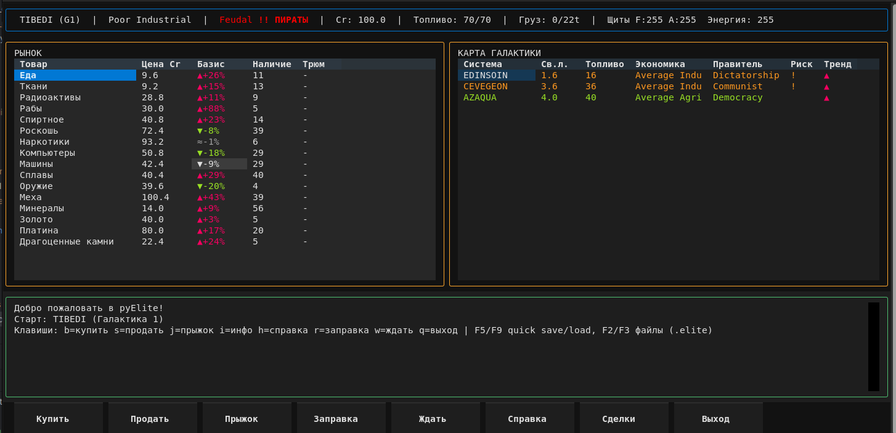
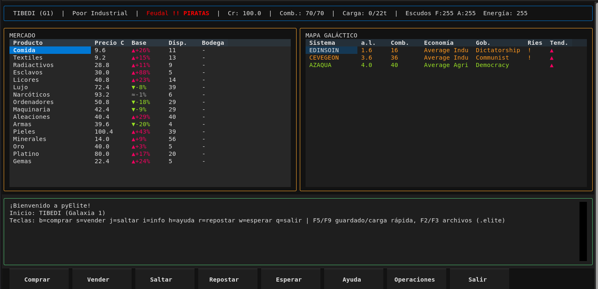

# pyElite = текстовый порт Elite на Python

Детерминированный порт игровой математики Elite (BBC Micro / C64, 1984)
на Python 3.10+. Воспроизводит генерацию галактик (256 систем x 8 галактик),
рынок товаров, гиперпрыжки, систему защиты корабля, боевые встречи с пиратами
и описания планет («goat soup»). Все расчёты детерминированы, модуль `random`
не используется.

Оригинал: Elite (Ian Bell & David Braben, 1984, BBC Micro / C64).
Источники: дизассемблирование с bbcelite.com (OOPS, OUCH, SHD, RESET,
DORND, TT111, TT24 и др.).

Требования: Python 3.10+. CLI не требует внешних зависимостей; для TUI
нужен Textual (`pip install -e ".[tui]"`). Кодировка UTF-8.

Целевая группа: геймеры, родившиеся в 1970 году или раньше.

## Скриншоты

Главное окно TUI (русский):



Главное окно TUI (испанский):



## Архитектура

Зависимости модулей (без циклов):

| Модуль                                                   | Описание                                                                                                                                                                                                                                                                         |
|----------------------------------------------------------|----------------------------------------------------------------------------------------------------------------------------------------------------------------------------------------------------------------------------------------------------------------------------------|
| [`elite_core.py`](elite_core.py)                         | Источник констант, типов, `MarketError`, `commodity_index()`, `ShipDefense`, `CombatEngine`, `GameState`, `DeterministicRNG`, `GalaxyGenerator`, `MarketEngine`, `JumpEngine`, `FuelEngine`, `SystemDescriptionEngine`. Импортирует только из `elite_galaxy_generator` и stdlib. |
| [`elite_galaxy_generator.py`](elite_galaxy_generator.py) | Генерация галактик (`EliteGalaxyGenerator`, `GalaxyGenerator`). Импортирует из stdlib.                                                                                                                                                                                           |
| [`elite_trading.py`](elite_trading.py)                   | Импортирует константы/типы из `elite_core`; `EliteGalaxyGenerator` из `elite_galaxy_generator`. Класс `EliteMarket`.                                                                                                                                                             |
| [`elite_jumps.py`](elite_jumps.py)                       | Импортирует `FUEL_TANK_CAPACITY`, `ENGINE_MAX_RANGE_UNITS`, `JumpResult` из `elite_core`; `EliteGalaxyGenerator` из `elite_galaxy_generator`. Класс `Hyperdrive`.                                                                                                                |
| [`elite_analytics.py`](elite_analytics.py)               | `EventLogger` (SQLite, записи помечаются `player_id`), `ProfitAnalyzer`, `RouteFinder` (BFS по графу систем).                                                                                                                                                                    |
| [`elite_autopilot.py`](elite_autopilot.py)               | Автономный бот: `Autopilot` (планирование ходов, торговля, бой), `TradeRoute`, `BotMemory` (SQLite-память самообучения: Q-learning, UCB1, Bayesian), `PLAYER_ID`. Импортирует из `elite_core` и `elite_analytics`.                                                               |
| [`elite_i18n.py`](elite_i18n.py)                         | `I18n` (EN, RU, ES), 100 ключей x 3 языка.                                                                                                                                                                                                                                       |
| [`elite_backend.py`](elite_backend.py)                   | Абстракции бекендов: протоколы `Renderer`/`AudioBackend`, `GameEvent`, фабрики `create_renderer()`/`create_audio()` (в поставке = "cli", "null").                                                                                                                                |
| [`elite_renderer_cli.py`](elite_renderer_cli.py)         | CLI-рендерер (`CLIRenderer`) = текстовый вывод для игрового цикла.                                                                                                                                                                                                               |
| [`elite_audio_null.py`](elite_audio_null.py)             | Заглушка аудио (`NullAudio`) = без звука.                                                                                                                                                                                                                                        |
| [`elite_tui.py`](elite_tui.py)                           | Полноэкранный TUI на Textual (`EliteTUI`): рынок, прыжки, бой, сохранения (F2/F3/F5/F9). Требует `textual`.                                                                                                                                                                      |
| [`elite_line_editor.py`](elite_line_editor.py)           | Линейный редактор с историей (используется CLI-циклом).                                                                                                                                                                                                                          |
| [`game_loop.py`](game_loop.py)                           | CLI-игровой цикл. Импортирует из `elite_core`, `elite_trading`, `elite_jumps`, `elite_analytics`, `elite_i18n`. Классы `GameState` (локальный), `GameLogger`, `GameLoop`.                                                                                                        |
| [`analyze_endings.py`](analyze_endings.py)               | Анализ причин окончания игр ботов из `elite_events.db` (piracy_drain, dead_end, stall, user_stop...), фильтр по `--player-id`.                                                                                                                                                   |
| [`tests/test_elite_core.py`](tests/test_elite_core.py)   | Тесты ядра: `DeterministicRNG`, константы, `commodity_index`, `GalaxyGenerator`, `MarketEngine`, `JumpEngine`, `FuelEngine`, `ShipDefense`, `CombatEngine`, `SystemDescriptionEngine`, `GameState`.                                                                              |
| [`tests/test_elite_i18n.py`](tests/test_elite_i18n.py)   | Тесты локализации: синхронность ключей, placeholder-ы, fallback, форматирование, Unicode.                                                                                                                                                                                        |
| [`tests/test_autopilot.py`](tests/test_autopilot.py)     | Тесты автопилота: планирование ходов, маршруты, BotMemory (Q/UCB1/Bayesian), разделение по `player_id`, калибровка (CREDIT_FLOOR, MIN_FUEL_RESERVE, DANGER_SKIP_THRESHOLD), банкротство.                                                                                         |
| [`tests/test_analytics.py`](tests/test_analytics.py)     | Тесты `EventLogger`: schema с `player_id`, миграция старых БД, фильтр `load_events`.                                                                                                                                                                                             |

## Модули (детально)

### elite_core.py = ядро

* **DeterministicRNG** = PRNG из оригинала (BBC: DORND, регистр «Twins»).
  Методы: `next_byte()`, `next_range(lo, hi)`, `next_word()`, `pick(thresholds)`.
* **Константы** = `SEED_GALAXY_0`, `NAME_PAIRS`, `ECONOMIES`, `GOVERNMENTS`,
  `COMMODITIES`, `MARKET_TABLE`, `UNIT_BY_FLAGS`, `DANGER_TABLE`,
  `SHIP_HOLD` (22), `PRECIOUS_LIMIT` (200), `FUEL_TANK_CAPACITY` (70),
  `FUEL_PRICE_PER_UNIT_CR` (0.2), `ENGINE_MAX_RANGE_UNITS` (256),
  `SHIP_DEFENSE_MAX` (255), `STARTING_CASH_UNITS` (1000).
* **Типы** = `Cargo` (`list[int]`, 17 категорий), `SystemRow`, `MarketRow`,
  `JumpResult`, `RefuelResult`, `CombatResult`.
* **`MarketError(ValueError)`** = ошибка торговой операции.
* **`commodity_index(item: str | int) -> int`** = индекс товара по имени
  (case-insensitive, prefix match) или номеру.
* **`ShipDefense`** = трёхслойная защита (FSH, ASH, ENERGY, 0-255).
* **`CombatEngine`** = `check_pirate_attack()`, `resolve(action, ...)`.
* **`GameState`** = `galaxy`, `system_index`, `fuel`, `credits`, `cargo`,
  `defense`, `rng`, `generator`, `market`, `jump_engine`, `fuel_engine`,
  `combat_engine`, `description_engine`. Методы: `buy()`, `sell()`, `jump()`,
  `refuel()`, `check_pirate_attack()`, `resolve_combat_action()`,
  `near_systems()`, `generate_description()`, `load_system()`
  (rebuild market + `defense.reset()`).

### elite_galaxy_generator.py = генерация галактик

* **`EliteGalaxyGenerator`** = `generate_galaxy(n) -> list[SystemRow]`,
  256 систем x 8 галактик. Поля: `x`, `y`, `economy`, `government`,
  `tech_level`, `population`, `productivity`, `radius`, `name`,
  `economy_name`, `government_name`.
* **`GalaxyGenerator`** = алиас/обёртка над `EliteGalaxyGenerator`.
* **Seed** = `tuple[int, int, int, int, int, int]` (6 байт, little-endian).

### elite_trading.py = рынок

* **`EliteMarket`** = `buy(item, qty) -> cost_cr`, `sell(item, qty) -> income_cr`,
  `get_market() -> list[MarketRow]`, `total_tonnes() -> int`.
* Внутренние деньги в «единицах» (1 ед. = 0.1 Cr); публичные методы
  возвращают Cr.

### elite_jumps.py = гиперпрыжки

* **`Hyperdrive`** = `distance_units(a, b) -> int`,
  `calculate_fuel_cost(a, b) -> int`, `can_jump(current, target, fuel) -> JumpResult`,
  `execute_jump(...) -> JumpResult`.
* **`_square_root(r, q)`** = целочисленный sqrt из ассемблера (long division,
  8 итераций, $9978).

### elite_analytics.py = анализ

* **`EventLogger`** = SQLite-лог прыжков, сделок, заправок, боёв. Каждая
  запись помечается `player_id` (версия бота; `__init__(db_path,
  player_id=0)`). Старые БД мигрируются автоматически: колонка
  `player_id INTEGER NOT NULL DEFAULT 0` добавляется через
  `ALTER TABLE`, все исторические записи получают `player_id=0`.
* **`ProfitAnalyzer`** = `find_best_deals()`, `find_best_deals_all_items()`.
* **`RouteFinder`** = `find_route_with_fuel()` = BFS по графу систем,
  рёбра =< 7.0 св. лет.

### elite_autopilot.py = автономный бот

Автоматический игрок: сам торгует, прыгает, заправляется и принимает
боевые решения напрямую через API `elite_core.GameState` (без парсинга
CLI). Всё детерминировано, модуль `random` используется только внутри
`BotMemory` (epsilon-greedy Q-learning).

Приоритеты планирования (`Autopilot._plan_turn`): продажа по хорошей цене ->
доставка груза -> анти-застревание -> покупка по лучшему маршруту ->
заправка -> исследовательский прыжок -> desperate jump -> dead_end/рестарт.

**Калибровка (константы `elite_autopilot.py`):**

* `CREDIT_FLOOR = 50.0` = если кредитов меньше и прибыльного маршрута нет,
  бот завершает игру `dead_end` (рестарт с 100 Cr выгоднее медленной смерти
  от заправок и пиратских атак).
* `MIN_FUEL_RESERVE = 5` = минимальный запас топлива для прыжка; позволяет
  цепочку прыжков 70 -> 38 -> 6 без заправки (при reserve=10 бот
  заправлялся бы после каждого прыжка >= 3 ly).
* `DANGER_SKIP_THRESHOLD = 0.2` = hard-фильтр: системы с P(атаки) >= 0.2
  полностью пропускаются во всех методах выбора цели (explore, sell,
  desperate). Системы, где хотя бы 1 из 5 визитов заканчивается атакой,
  исключаются из маршрутов.
* `EARLY_GAME_CREDITS = 500`, `MID_GAME_CREDITS = 2000` = прогрессивная
  стратегия: ранняя игра торгует только Food/Textiles/Minerals с прыжками
  до 5 ly, средняя и поздняя открывают Liquor/Wines, Computers, Machinery
  и драгметаллы.

**Память самообучения (`BotMemory`, SQLite `bot_memory.db`):**

* Q-learning = выбор боевого действия fight/flee/surrender (epsilon-greedy,
  epsilon затухает 0.15 -> 0.02 за ~500 раундов);
* UCB1 (multi-armed bandit) = баланс explore/exploit торговых маршрутов;
* Bayesian (Beta-распределение) = оценка опасности систем по фактической
  частоте атак с prior по правительству.

**Разделение данных версий бота (`player_id`):**

Новая версия бота = новый `PLAYER_ID` (`PLAYER_ID = 2` в
`elite_autopilot.py`). Данные разных версий хранятся в одних файлах БД,
но не смешиваются:

* `bot_memory.db` = таблицы `combat_q`, `route_stats`, `system_stats`
  имеют `PRIMARY KEY (player_id, ...)`; таблица `meta` = без `player_id`
  (счётчик `total_rounds` глобальный: epsilon-decay и UCB1 не зависят от
  версии);
* `elite_events.db` = каждая транзакция `EventLogger` помечена
  `player_id`;
* старые БД мигрируются автоматически при первом открытии: все
  исторические данные получают `player_id=0`.

Запуск: `python3 elite_autopilot.py` (один прогон) или
`./bot_autoplay.sh` (бесконечные перезапуски, Ctrl-C = стоп).
Лог событий: `elite_events.db`; память самообучения: `bot_memory.db`.

### analyze_endings.py = анализ окончаний игр

Сводка причин окончания игр ботов по `elite_events.db` (destroyed,
piracy_drain, dead_end, stall, user_stop, unknown), детали по каждой игре,
топ опасных систем и тренды.

```bash
python3 analyze_endings.py                  # все игроки
python3 analyze_endings.py elite_events.db  # указанный файл БД
python3 analyze_endings.py --player-id 2    # только записи версии бота 2
```

`--player-id N` фильтрует транзакции по колонке `player_id`; без флага =
все версии (в заголовке отчёта выводится `Player ID: ALL`).

### elite_i18n.py = локализация

* **`I18n`** = `tr(key, **kwargs)`, `set_locale(lang)`, `available_locales()`.
* 100 ключей x 3 языка (EN, RU, ES). Fallback: локаль -> EN -> ключ.
* Бразильский португальский (pt-BR) = добавляется по запросу.

### game_loop.py = CLI

* **`GameLoop`** = интерактивный цикл, разбор команд, вызов обработчиков.
* **`GameState`** (локальный класс) = `galaxy`, `system_index`, `fuel`,
  `credits`, `cargo`, `defense`, `hyperdrive`, `market`. Связь с
  `CoreGameState` через `_core_state()`.
* **`GameLogger`** = CSV-лог (`log/game_log.csv`).
* 15 команд (см. ниже).

## Команды CLI

| Команда              | Аргументы              | Описание                                |
|----------------------|------------------------|-----------------------------------------|
| `status`             | =                      | Система, топливо, груз, кредиты, защита |
| `market`             | =                      | Таблица цен и наличия товаров           |
| `near`               | =                      | Системы в радиусе прыжка                |
| `buy <item> <qty>`   | имя/индекс, количество | Купить товар                            |
| `sell <item> <qty>`  | имя/индекс, количество | Продать товар                           |
| `jump <index>`       | индекс системы (0-255) | Гиперпрыжок + проверка пиратской атаки  |
| `refuel`             | =                      | Заправка до полного бака (0.2 Cr/ед.)   |
| `route <index>`      | индекс системы         | Кратчайший маршрут (BFS)                |
| `profit [item]`      | имя товара (опц.)      | Топ-10 сделок по прибыли                |
| `profit-top [N]`     | число (опц.)           | Топ-N сделок по всем товарам            |
| `combat <action>`    | fight/escape/surrender | Бой с пиратами (вручную)                |
| `info`               | =                      | Описание текущей планеты                |
| `save <file>`        | путь к файлу           | Сохранение в JSON                       |
| `load <file>`        | путь к файлу           | Загрузка из JSON                        |
| `lang [code]`        | en/ru/es (опц.)        | Переключение языка интерфейса           |
| `help`               | =                      | Список команд                           |
| `quit`               | =                      | Выход                                   |

Стартовая позиция: галактика 0, система #0 TIBEDI, топливо 70 ед.
(7.0 св. лет), кредиты 100.0 Cr, пустой трюм (22 т).

## Модель защиты корабля

Трёхслойная защита (BBC Elite: FSH, ASH, ENERGY), каждая 0-255:

* **Forward Shield (FSH)** = носовой щит, поглощает урон спереди (fight).
* **Aft Shield (ASH)** = кормовой щит, поглощает урон сзади (escape).
* **Energy (ENERGY)** = энергобатарея, поглощает переполнение щита.

**OOPS (обработка урона):**

1. `shield -= damage`; если `shield >= 0` = щит выдержал.
2. если `shield < 0` = `shield = 0`, избыток идёт в `ENERGY`.
3. `ENERGY -= overflow`; если `ENERGY <= 0` = корабль уничтожен (GAME OVER).
4. `ENERGY > 0` = вызов OUCH.

**OUCH (потеря груза, ~4.5% шанс):**

* DORND -> A, X; `A >= 128` (50%) -> ничего; `X >= 22` (91%) -> ничего;
  `cargo[X] == 0` -> ничего; иначе `cargo[X] = 0` (уничтожить товар).
* Оборудование (индексы 17-21) не реализовано.

**SHD (перезарядка щитов):**

* Щиты +1 (стоимость 1 ед. энергии), только если `ENERGY >= 128` (>50%).
* Энергия +1 за раунд.

**RESET (перезарядка на стыковке):**

* `FSH = ASH = ENERGY = 255` (RES4: `LDA #$FF; STA FSH,X`).

## Боевая система

Триггер: после каждого прыжка автоматически проверяется пиратская атака
(`check_pirate_attack`: DORND < `DANGER[government]`). Если атака = игрок
выбирает действие в интерактиве (fight / escape / surrender).

Действия:

* **fight** = 3-5 раундов урона по forward shield (40-119 ед./раунд);
  шанс победы = `(0x80 + tech_level * 8) / 256`;
  проигрыш = 25% груза + 20% кредитов.
* **escape** = 1-2 раунда урона по aft shield (30-80 ед./раунд);
  тратит 1-10 ед. топлива; успех, если `DORND < min(255, fuel * 3)`;
  провал = 15% груза.
* **surrender** = без урона; потеря 10-50% кредитов + 25% груза.

Гибель: `ENERGY <= 0` -> GAME OVER -> рестарт с базовым снаряжением
(галактика 0, TIBEDI, топливо 70, кредиты 100, пустой трюм, полная защита).

Перезарядка: при стыковке (`load_system`) = `defense.reset()`
(FSH = ASH = ENERGY = 255).

## Тесты

Текстовый набор = pytest: 456 passed, 1 skipped (`tests/`).
GUI/pygame-тесты не входят в этот репозиторий.

```bash
.venv/bin/python -m pytest           # все тесты
.venv/bin/python -m pytest -q        # краткий вывод
.venv/bin/python -m pytest tests/test_autopilot.py   # только автопилот
```

Покрытие: ядро (`tests/test_elite_core.py` = RNG, рынок, прыжки, защита,
бой, GameState), локализация (`tests/test_elite_i18n.py`), автопилот
(`tests/test_autopilot.py` = планирование, маршруты, BotMemory,
player_id-разделение, калибровка, банкротство), EventLogger
(`tests/test_analytics.py` = schema, player_id, миграция), CLI-цикл,
backend, рендереры (CLI), аудио (null), TUI, линейный редактор.

## Быстрый старт

```bash
./run_cli.sh                 # интерактивный CLI
./run_tui.sh                 # полноэкранный TUI (нужен textual)
./bot_autoplay.sh            # бесконечный прогон автопилота (Ctrl-C = стоп)
.venv/bin/python -m pytest   # тесты
```

Все файлы должны лежать в одной директории (рядом с
`elite_galaxy_generator.py` и `elite_analytics.py`, которые требуются для
импорта).

## Источники

* Оригинал: Elite (Ian Bell & David Braben, 1984, BBC Micro / Acorn Electron /
  Commodore 64).
* Дизассемблирование: bbcelite.com = подпрограммы OOPS, OUCH, SHD, RESET,
  DEATH, DORND, TT111, TT24, TT22, square_root ($9978), goat soup.
* Файлы исходников: `src/code_6a00.asm`, `src/code_28ba.asm`,
  `src/save_data.asm`, `src/text/text_docked.asm`, `src/text/text_flight.asm`,
  `src/vars_main.asm`, `src/vars_ships.asm`, `src/vars_zeropage.asm`,
  `src/math/math_square.asm`.

## Лицензия и авторские права

"Elite" is copyright David Braben & Ian Bell, Acornsoft (BBC / Electron
versions), Firebird / British Telecom (C64 version), 1984-1985, all rights
reserved. The name "Elite" is used in this project for historical, educational
and archival purposes only.

Оригинальный Python-код этого проекта (архитектура, CLI, TUI, i18n,
аналитика, тесты) распространяется под GNU GPL v3 = см. [LICENSE](LICENSE).

Игровые данные и механики, производные от оригинальной Elite (таблицы
систем, товаров, экономик, правительств, описания планет «goat soup»,
PRNG DORND и др.), остаются интеллектуальной собственностью их
правообладателей и НЕ покрываются лицензией GPL v3. Они включены в проект
исключительно в образовательных и некоммерческих целях, с указанием
источников (bbcelite.com, релизы исходников Иэна Белла).

Проект не содержит оригинальных ROM-образов, бинарников, графики, музыки
и звука игры. Проект некоммерческий: распространение и использование
допускается только в некоммерческих целях.